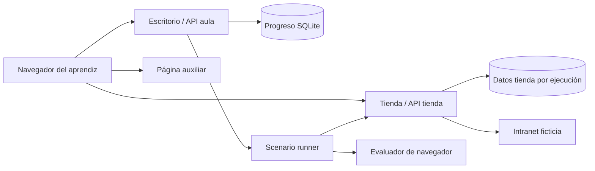

# Arquitectura propuesta y límites

## Componentes

React + TypeScript + Vite para dos interfaces separadas. Node.js + TypeScript + Express para API de aula y tienda. SQLite en dos almacenamientos sin privilegios compartidos. Se verificarán versiones compatibles y se fijará un lockfile al implementar; esta etapa no instala dependencias ni afirma versiones actuales.

| Componente | Responsabilidad | Acceso previsto |
|---|---|---|
| apps/classroom + classroom-api | Buzón, notas, campaña, filtro de contenidos y profesor | `http://localhost:4310`, publicación `127.0.0.1:4310` |
| apps/storefront + store-api | Catálogo y conductas de negocio delimitadas | `http://127.0.0.1:4311`, publicación `127.0.0.1:4311` |
| Página auxiliar | Formularios y pruebas entre orígenes | `http://127.0.0.1:4312`, publicación `127.0.0.1:4312` |
| scenario-runner | Preparación, eventos, reloj y evaluación | Sin puerto publicado; servidor autenticado al aula |
| mock-intranet | Catálogo de proveedor e intranet sintética | Sin puerto publicado; red interna |
| Evaluador de navegador | Contextos limpios, sin perfiles del usuario | Red de laboratorio; sin host ni montajes de progreso |

Las URL son configuración propuesta. El inicio deberá resolver `localhost` a loopback y probarlo; si solo resuelve IPv6 y no llega a la publicación IPv4, explicará el conflicto. No se aceptará sustituir automáticamente el host del aula por el de la tienda, porque eliminaría la separación de cookies. No se requiere DNS externo ni editar hosts para la propuesta base.

## Cookies, orígenes y confianza

Sesión de aula `ug_classroom`, HttpOnly, SameSite=Strict, Path=/ y sin Domain; tienda `ug_store`, HttpOnly, SameSite=Lax explícito, Path=/ y sin Domain. En HTTP local no se promete Secure ni se utilizan prefijos que lo requieren. Para una futura instalación HTTPS se revisará esta política.

El host distinto separa aula y tienda; un puerto distinto por sí solo no lo hace. La página auxiliar y la tienda comparten host y por tanto pueden compartir cookies de tienda. Eso es deliberado en el capítulo 42, cuyo ensayo es entre orígenes del mismo sitio. Sus correcciones comprueban token sincronizador y Origin exacto en operaciones mutables. La autenticación y la propiedad siguen siendo controles independientes. Las rutas del aula también comprueban Origin, tipo de contenido y token CSRF; ninguna API del aula concede escritura a la tienda.

Los capítulos CORS prueban lectura en navegador desde 4312 hacia 4311 con credenciales, origen permitido explícito y alternativa denegada. No se sustituye autorización por CORS. El validador registra si la solicitud llegó y por separado si el código del navegador pudo leer su cuerpo. Todas estas conductas están pendientes de prueba real.

Referencias consultadas: [Set-Cookie (MDN)](https://developer.mozilla.org/en-US/docs/Web/HTTP/Reference/Headers/Set-Cookie), [Red y apertura (Firefox)](https://firefox-source-docs.mozilla.org/devtools-user/network_monitor/index.html), [detalles y reenvío de solicitudes (Firefox)](https://firefox-source-docs.mozilla.org/devtools-user/network_monitor/request_details/). Sustentan el mecanismo propuesto, no certifican esta implementación aún inexistente.

## Aislamiento de datos y ejecución

El proceso de tienda recibe exclusivamente su base de datos por ejecución y el árbol virtual de documentos. No monta el código de profesor, el volumen de progreso, el socket Docker ni directorios del anfitrión. El aula monta únicamente su almacenamiento. El runner crea snapshots por canales internos con autenticación de servicio; la tienda no tiene esa credencial. La observación de tienda no se convierte automáticamente en logro: el runner verifica identidad, objeto, versión, ejecución y estado persistido.

Los contenedores se ejecutarán sin root, sin capacidades adicionales, con raíz de solo lectura y tmpfs acotado cuando sea posible. Docker Compose publicará únicamente en loopback. La red de negocio será interna, con conectividad declarada al evaluador y al guardián de salida. No debe suponerse que `internal: true` impide todos los accesos al gateway del host: se probarán las rutas reales y se añadirá denegación de salida independiente. Los contenedores nunca requieren privilegios del anfitrión.

Archivos: el ejercicio 37 usa un sistema virtual de claves y carpetas; incluso una ruta con `../../` se evalúa en ese árbol. Nunca se resuelve sobre el sistema real. Subidas limitadas a muestras de etiquetas y tamaño conocido, sin ejecutar contenido y fuera de la publicación estática. La política corregida comprueba formato, tamaño, nombre generado y servicio de descarga.

SSRF: entrada limitada a destinos sintéticos predefinidos; validación de negocio vulnerable suficientemente real para consultar un destino interno indebido, mientras un guardián fuera de esa lógica impide cualquier otro destino. Sin redirecciones automáticas, credenciales en URL, esquemas alternativos, resoluciones controladas por alumno o proxies de entorno. Se contrastará IP efectiva y no solo texto del host.

XSS: contexto desechable sin cookies del aula, sin acceso a redes exteriores, descargas ni navegación arbitraria. Marca DOM local como efecto, con nonce ligado a ejecución y captura del recorrido. Marcar un elemento manualmente no basta: se reproduce la entrada en otro contexto limpio. No se transporta al evaluador un script arbitrario del alumno sin recinto. El evaluador no visita URLs arbitrarias.

## Persistencia

Progreso: campañas, generaciones, habilidades, notas, referencias de evidencias, objetos ganados, correcciones principales y archivo de snapshots. Tienda: usuarios ficticios, sesiones, productos, pedidos y eventos por runId. No se comparten tablas ni un fichero SQLite. Las cookies identifican una sesión, pero la base de progreso es la autoridad.

Reintentar crea otro runId, conserva progreso y elimina únicamente los datos del escenario anterior tras archivar su diagnóstico. Crear campaña produce otro ID y archiva la anterior. Restablecer ofrece exportación y confirmación, archiva un snapshot y aumenta generación. No hay borrado automático de archivos recuperables; la depuración futura será una acción explícita del usuario.

Exportación versionada `ug-progress/1`: versión de contenido, campaña, generación, notas, objetos y logros históricos. Importación en transacción valida tamaño, esquema, compatibilidad y procedencia; IDs se regeneran para una copia y no se aceptan URLs ni código. Un checksum solo comprueba integridad accidental, no autoría. No se presenta como mecanismo antitrampas. No se importan cookies ni credenciales de servicio. Restaurar una versión anterior a un reset solo crea una copia archivada, nunca sobrescribe la activa por una cookie vieja.

## Instalación en Kali y VM

Si el laboratorio corre dentro de Kali, abrir las tres direcciones dentro de su navegador: loopback pertenece a Kali. Si corre en macOS, esas direcciones pertenecen a macOS; no apuntan a él desde Kali. La primera versión no publicará el laboratorio sobre la red de la VM para resolverlo. Opciones previstas: ejecutar Docker dentro de Kali cuando sea compatible, o usar el navegador del anfitrión. Un túnel explícito requerirá documentación y prueba propia; no se cambiará a `0.0.0.0` silenciosamente.

No se ha arrancado Docker, evaluado sus redes ni probado arquitecturas ARM64/AMD64. El aislamiento propuesto reduce superficie; no se considera infalible.

## Implementación de la Etapa2

01–05 utilizan los dos primeros servicios. El runner es un módulo del proceso de aula, separado de la lógica narrativa; por ahora no requiere un tercer contenedor. El canal de control autenticado4313 solo escucha loopback al ejecutar npm y no se publica en Compose. Store API no monta progreso ni importa repositorio de aula. La separación por proceso y bases se ha probado; el recinto Docker continúa pendiente.

El evaluador de presentación usa Chromium con un contexto nuevo y tickets de un uso. Solo navega a rutas fijas del propio laboratorio; no recibe URL del alumno. Su informe se guarda con runId y se exporta con el cuaderno. En Docker el origen interno del evaluador se configura aparte del origen que abre el alumno.

El alumnado mantiene un origen localhost y otro127.0.0.1. La prueba de navegador confirmó cookies host-only distintas. Esto cubre01–05; no constituye una prueba anticipada de CORS, CSRF o cookies entre los orígenes de41–45. No se ejecutan aún páginas auxiliares, intranet ni cargas de ejecución.

Consultar INSTALACION.md y ESTADO.md para resultados actuales y limitaciones. Las secciones anteriores describen la arquitectura objetivo de la campaña completa.

## ActoII · base implementada0.3

La tienda añade lab_users, auth_sessions y lab_orders por runId mediante migración aditiva. Las contraseñas ficticias se derivan con scrypt y sal por fila; las sesiones guardan hash del token, referencia no secreta, revocación y vencimiento. En07–11 /api/me devuelve userId y name; desde12 incorpora preferencia, rol y capacidad interna para las pruebas del ActoIII.

ug_lab es contexto anónimo de escenario; ug_store es autenticación de cuenta. Un nuevo lanzamiento limpia ug_store y prepara ug_lab. Hay fallback de contexto0.2 para no borrar datos. La identidad de cuenta se valida siempre contra el run activo; la cookie de una copia no autoriza otra.

El recurso público de verano se genera solo con datos de demostración para la copia06. No autentica al alumno ni concede funciones del aula. Las comparaciones del runner crean copias con la misma versión, cuentas y propietarios y controles corregidos; no invalidan la práctica original. Se retiran al terminar y conservan sus eventos. El aula no entrega contraseñas en estado ni exportación: solo mediante solicitud explícita de un objeto autorizado por checkpoint.

La importación admite contenido1/2 y mantiene el contenedor ug-progress/1. Cada copia importada recibe otro ID y conserva evidencia como histórica. Se prueban reintento, reinicio, recuperación y cancelación de una comparación sin perder una nota concurrente.

## Acto III · base implementada0.4

act-three.ts separa perfil, soporte y errores. lab_users añade preference, support_access y role; runs añade profile_allowlist y error_clean. Migraciones aditivas, sin borrar bases existentes. Preferencia y capacidad se escriben en la copia de cada run. Asignar role o cualquier campo no previsto se rechaza; la vulnerabilidad didáctica13/15 afecta exclusivamente a supportAccess y se observa mediante un recurso restringido real.

La mesa limita recursos al catálogo del expediente, usa XHR y conserva como máximo30 observaciones en sessionStorage por copia. No almacena cuerpos de acceso ni contraseñas. No comunica al aula un marcador de completado: el validador comprueba identidad, secuencia, sesión y eventos del run.

En15 comparisonRunId identifica una segunda copia. Tickets nuevos limpian la sesión de cuenta. X-UG-Copy protege mesas/páginas antiguas frente a cambios de copia en otra pestaña. El verificador crea una tercera copia aislada y la retira al terminar; no mezcla sus eventos con las pruebas del alumno. c.patches conserva controles principales; los actos posteriores deberán heredarlos explícitamente al preparar sus escenarios.

Importación admite contenido1/2/3, con límites05/10/15. Referencias de copia, cookies y runs activos no se importan. Correcciones comprobadas e informes históricos sobreviven aunque la comprensión estuviera pendiente. No constituyen nuevas peticiones acreditadas.

## Acto IV · implementación vigente0.5

store-api/act-four.ts mantiene practice_orders, practice_content y practice_reviews por run. runs incorpora quantity_checked, description_text, message_text, review_text y demo_nonce mediante migración aditiva. No se alteran propietarios ni bases anteriores. Las entradas de las muestras tienen gramática acotada en shared/act-four.ts.

practice-frame.ts produce una página de marco con CSP propia, origen opaco por sandbox y bootstrap con nonce distinto del identificador público de la demostración. Permite un solo manejador conocido por hash, una imagen local ficticia y ningún connect-src. La página principal usa iframe allow-scripts sin allow-same-origin y su CSP no se debilita. No se usa eval ni se admite un programa arbitrario del alumno. Las rutas del recinto son fijas; el evaluador bloquea solicitudes de navegador fuera del origen de tienda configurado.

El fragmento mensajeSource es compartido por la vista pública y la página del marco: URLSearchParams→#mensaje→innerHTML/textContent según copia. En descripciones y reseñas, el dato se obtiene de SQLite; se serializa de forma segura al bootstrap y se inserta únicamente dentro del marco. La entrada de mensaje se lee de la URL real del marco.

scenario-runner/act-four.ts crea contextos nuevos sin cookie del aula. Reproduce17–20 desde estado de servidor o URL fija construida por el runner. El20 valida autora, lector, sesión y referencia exacta; las marcas DOM o postMessage del navegador del alumno no son autoridad. Evidencia conserva un informe de reproducción; corrección conserva prueba positiva y negativa en otra copia que se retira al terminar.

Se heredan controles del15 y quantity-rule después16. dom-message-text queda disponible después19 y review-text para los siguientes actos; el20 todavía usa una representación de reseña vulnerable como práctica hasta consolidar su propia corrección. El soporte de importación amplía contenido a4 y mantiene los límites de versiones previas y la condición histórica de las reproducciones.
